# 浑天图谱 · Armillary

> 远看是浑天仪，近看是地图：把 AI 开源项目脚下的“地基”画成一座可以查证的星系。

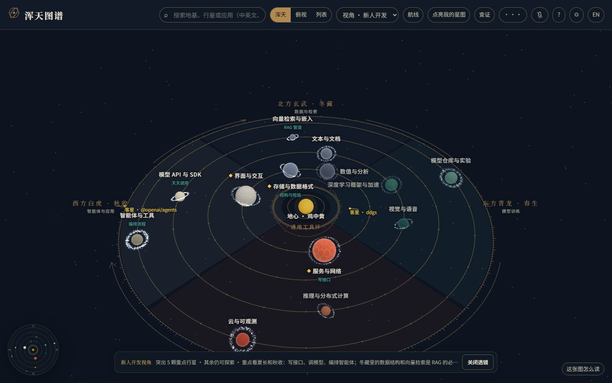

浑天图谱是一个面向 AI 行业新人的开源生态地图。它扫描了数百个高星 AI 应用的依赖，找出它们共同站立的上千个“地基”（被广泛依赖的开源包），按能力领域排成一座星系。新人不需要先读完几十个仓库，也能在几分钟里看清：一个 AI 应用由哪几层拼成，自己手上的项目站在哪些地基上，下一步该先学什么。

**在线体验：<https://soranzsh.github.io/armillary/>**（建议用电脑浏览器打开）

本仓库介绍产品的设计理念和价值，在线体验版放在 `gh-pages` 分支，只含构建后的页面和数据。**核心源码暂不公开。**

---

## 它解决什么问题

刚入行的开发、产品经理、测试和算法新人接手一个陌生的 AI 项目时，常卡在同一个地方：依赖清单里有几十上百个包，不知道哪些是关键，它们之间是什么关系，该从哪里学起。

现有的工具各解决了一部分，但都不是为新人设计的：

| 已有做法 | 好在哪里 | 新人用起来的问题 |
|---|---|---|
| 依赖图、3D 依赖星空 | 关系完整，画面震撼 | 满屏连线，适合惊叹，读不出重点 |
| 技术雷达 | 分区清楚，有观点 | 全靠人工评审，看不出谁依赖谁 |
| 生态全景图（logo 墙） | 覆盖面广，可筛选 | 平铺排列，没有层次和顺序 |
| 逐个读 README | 最准确 | 太慢，也看不到全局 |

浑天图谱要同时做到三件事：**一眼看到全局，任何结论都能查证，按你的职业给出学习顺序。**

## 星系里有什么

| 天体 | 代表什么 |
|---|---|
| **地心** | Linux、编译器、CPython、OpenSSL 这类元基础，是一切的底座 |
| **行星** | 一个能力领域，例如“推理与分布式计算”“向量检索与嵌入”。共 13 颗，每颗由几个细分“分区”组成 |
| **卫星带** | 环绕行星的星尘：以这颗行星为最外层落脚点的高星 AI 应用。点击展开，应用从星尘里逐个铺开 |
| **通用工具环** | 地心外的一圈铜环：Python、Node.js 的通用工具库。约定是**星尘 = 应用，铜环 = 工具** |
| **地基** | 行星上的一个个开源包，每个都有一张地基卡：它是什么、没有它之前怎么办、对你的职业意味着什么 |
| **客星、暗物质** | 新崛起的地基；以及被大量依赖、却很少被人注意到的底层包 |

越靠近中心，这个领域的代表包平均越接近依赖底层。四个扇区顺着 AI 的生命周期排成一圈，对应“春生夏长秋收冬藏”：

| 方位 | 季节 | 领域 |
|---|---|---|
| 北方玄武 | 冬藏 | 数据与检索：数据像水一样汇聚沉淀 |
| 东方青龙 | 春生 | 模型训练：模型从数据里长出来 |
| 南方朱雀 | 夏长 | 推理与部署：算力如火 |
| 西方白虎 | 秋收 | 智能体与应用：把模型能力收成产品 |

## 产品价值

**1. 几分钟建立全局观**
四季扇区给出一条顺时针的主线：数据 → 训练 → 推理 → 应用。新人先记住这一圈，再逐个点开行星，不会迷失在依赖细节里。

**2. 读懂自己手上的项目**
粘贴 GitHub 地址或依赖清单，得到一张可核对的“回执”：
- 读到了哪些清单文件；
- 直接依赖分为地基、已收录但未达门槛、未收录三类；
- 间接用到了哪些地基；
- 检测到哪些外部引擎的客户端；
- 只凭清单判断不了的部分，也会如实列出。

**3. 每个结论都能查证**
任选两个地基，“查证”会分三段给证据：完整的依赖链、是否属于同一领域、哪些项目同时用过它们。每一段都写明“图中没有收录不等于一定没有关系”。

**4. 按职业给出学习顺序**
新人开发、产品经理、测试、算法新人看到的地图各不相同：
- 职业透镜突出各自的重点行星，并标出“对你意味着什么”；
- 每个职业有两趟“远征”（一趟入门、一趟任务），例如产品经理的“AI 客服账单超预算，从哪几层降本”；远征在观星里进行，是主线的进阶段；
- 每到一站先答一道题——在这个任务里，这一站对应哪一环——再读这一站回答的问题、依赖证据和自查；路线顺着四季方向绕地心走，不来回折返。

**5. 先知道在做什么，再从一道题开始**
首次进入只有一页欢迎卡：这是什么图、在这里做什么、你是哪类新人。接着用一两分钟带着走五步——整张图怎么读、职业视角、点一颗行星、读行星卡、主线“观星”——最后一步直接进第一道观测题，例如“下面哪一个能和它互相替换？”。不想看可以跳过；查证面板里另有两道例题，例如“一个 Web 服务靠谁检查数据？”。

## 功能一览

| | |
|---|---|
| 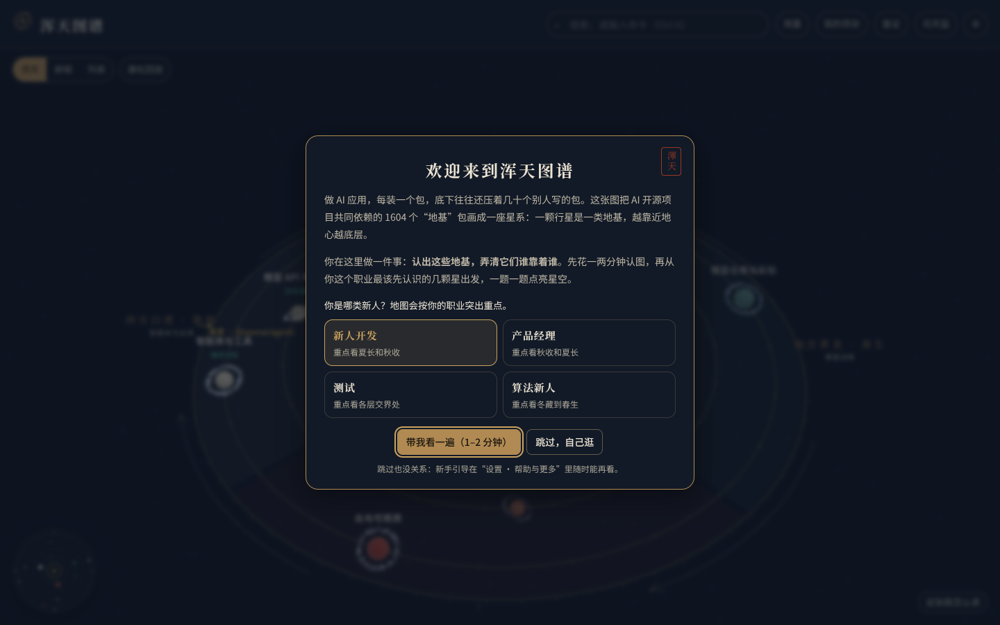 | 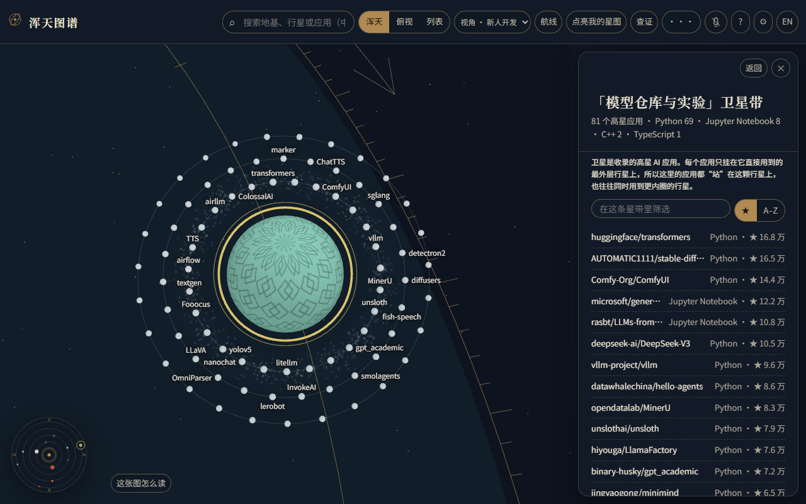 |
| **欢迎卡**：先说清这是什么、要做什么，再带着走五步 | **卫星带**：点击星尘，高星应用逐个铺开 |
| 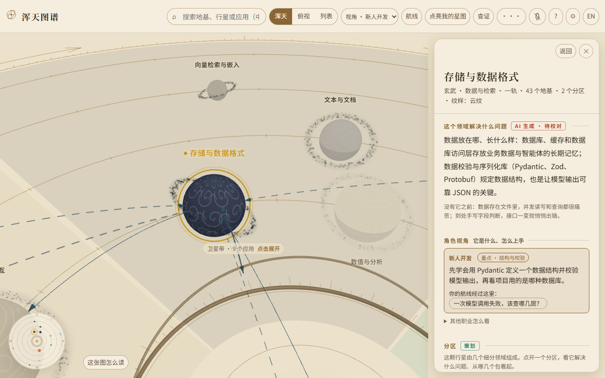 | 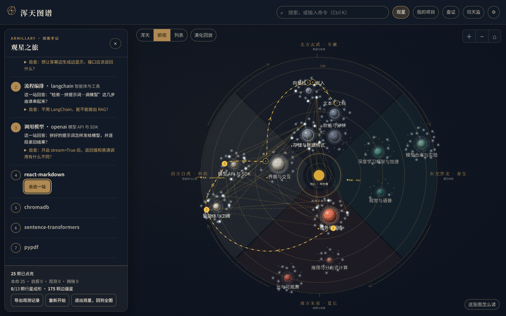 |
| **行星卡**：分区、入门成员、职业视角（绢本主题） | **远征**：每到一站答一道题，到过的站填成金色 |
| 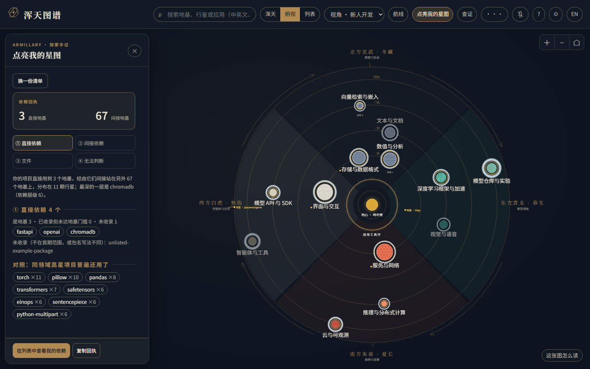 | 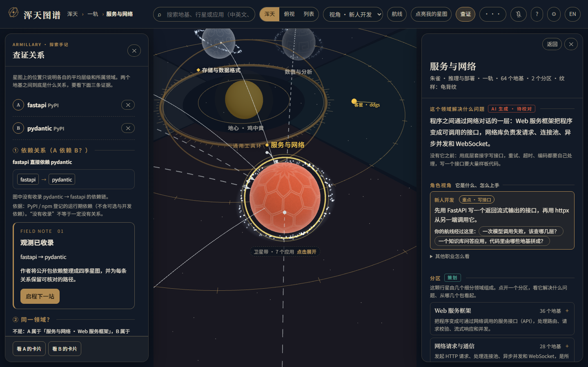 |
| **回执**：你的项目站在哪些地基上 | **查证**：依赖链、同一领域、共同使用 |
| 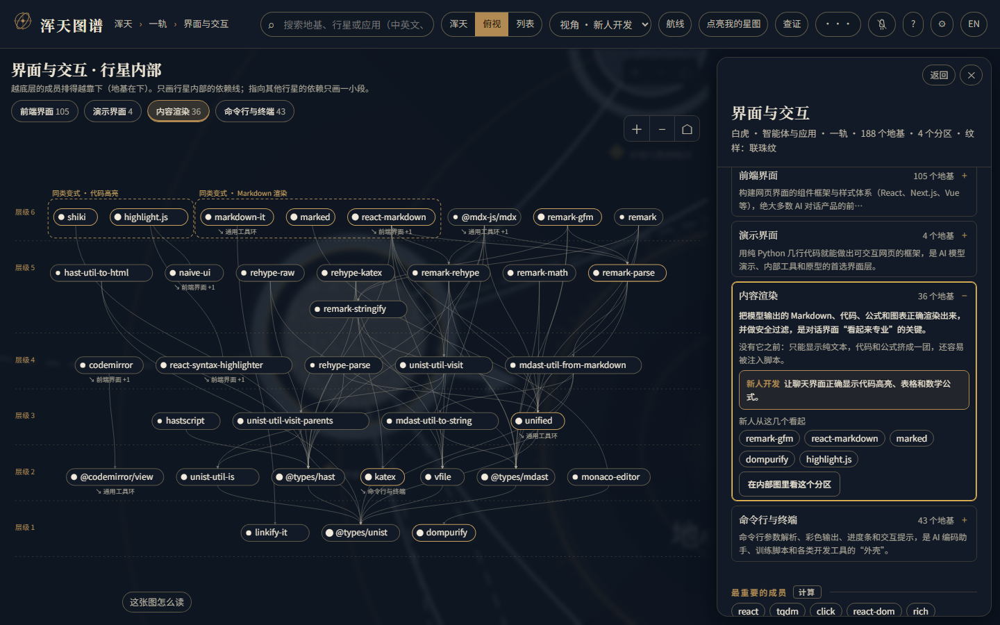 | 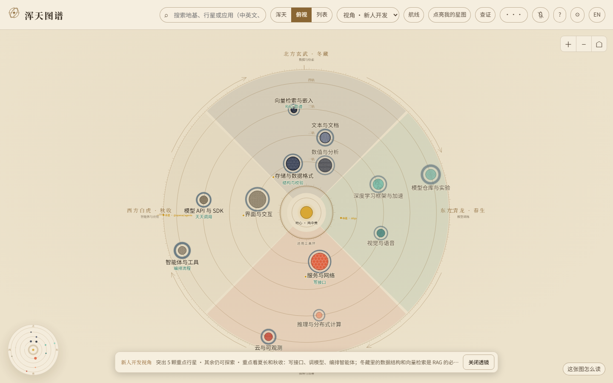 |
| **行星内部**：按分区分页的分层依赖图 | **三种视图**：3D 浑天、2D 俯视、列表 |

手机上默认使用 2D 俯视，观星、远征、回执、查证都可完整使用：

| | |
|---|---|
| 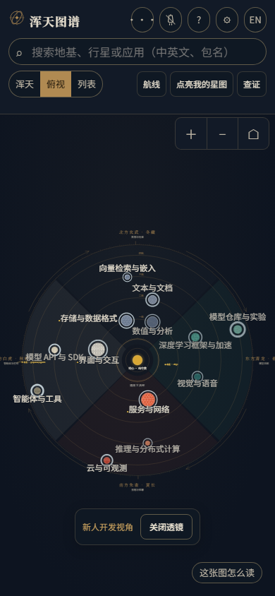 | 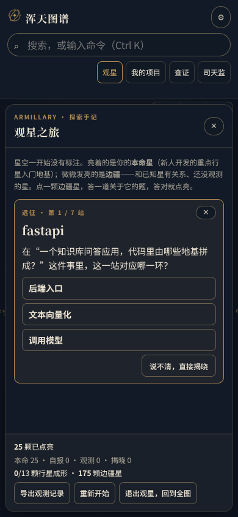 |

其他能力：
- 搜索（中英文名、包名、模糊匹配）；
- 演化回放；
- 5 条导览；
- 中英双语；
- 每个视图都有可分享的链接，Esc 逐级返回；
- 根据设备性能自动降级画质，尊重系统的“减少动态效果”设置。

## 设计理念（摘要）

完整内容见 [docs/设计理念.md](docs/设计理念.md)。

- **3D 必须挣得它的位置。** 3D 只负责总览和定位，一切需要阅读、比较、学习的内容回到 2D。
- **一个视觉通道只编码一件事。** 半径是层级，颜色是扇区，大小是承重度，转速是活跃度。
- **说清楚圈层说什么、不说什么。** 外圈不等于“依赖内圈”；两个具体地基的关系，一律用证据说话。
- **减少视觉焦点。** 30 多个细分领域合成 13 颗行星；300 个应用画成卫星带，不画成 300 颗小球。
- **事实、策划、AI 讲解分层标注。** 计算出的指标、人工策划的内容、AI 撰写的讲解，在界面上用不同标记区分。
- **每个“打开”都能关回去。** 受限导航、面包屑、罗盘、逐级返回，新人不会迷路。
- **浑天中国风。** 玄青与宣纸白的底色，四象配色，铜环刻度，古琴、笙、箫合成的背景音，五音配五方的点击音色。

## 数据规模（2026 年 11 月）

| 指标 | 数量 |
|---|---|
| 扫描的高星 AI 应用 | 361 个（上图成为卫星的 300 个，未上图的每一个都写明原因） |
| 扫描的开源包 | 10,285 个（PyPI + npm 完整运行期依赖） |
| 判定的地基 | 1,616 个，其中暗物质 99 个 |
| 行星 / 分区 | 13 颗可见行星，32 个分区，外加通用工具环 |
| 双语地基讲解 | 438 张 |
| 远征 | 4 个职业 × 2 趟 |

数据来自 PyPI、npm、ecosyste.ms、deps.dev 与 GitHub 的公开接口，可每周更新。

## 进展与计划

- [x] 数据管线、2D 俯视星图、列表视图
- [x] 3D 浑天总览、卫星带、行星内部、地基卡
- [x] 回执、查证、职业透镜与远征、导览、演化回放
- [x] 新手引导、声音设计、绢本主题、手机适配
- [ ] 领域专家评审分组与讲解，新人小样本试点
- [ ] 公开上线（永久免费；设自愿打赏，不解锁任何功能，只用于平台维护与完善）
- [ ] 支持 Go、Rust 生态
- [ ] 地基卡静态页，便于搜索引擎收录

## 关于源码与版权

核心源码、策划数据与数据管线暂不公开。本仓库中的文字、图片与设计内容版权所有，详见 [LICENSE](LICENSE)。欢迎引用和讨论，请注明出处。

作者：Soran
